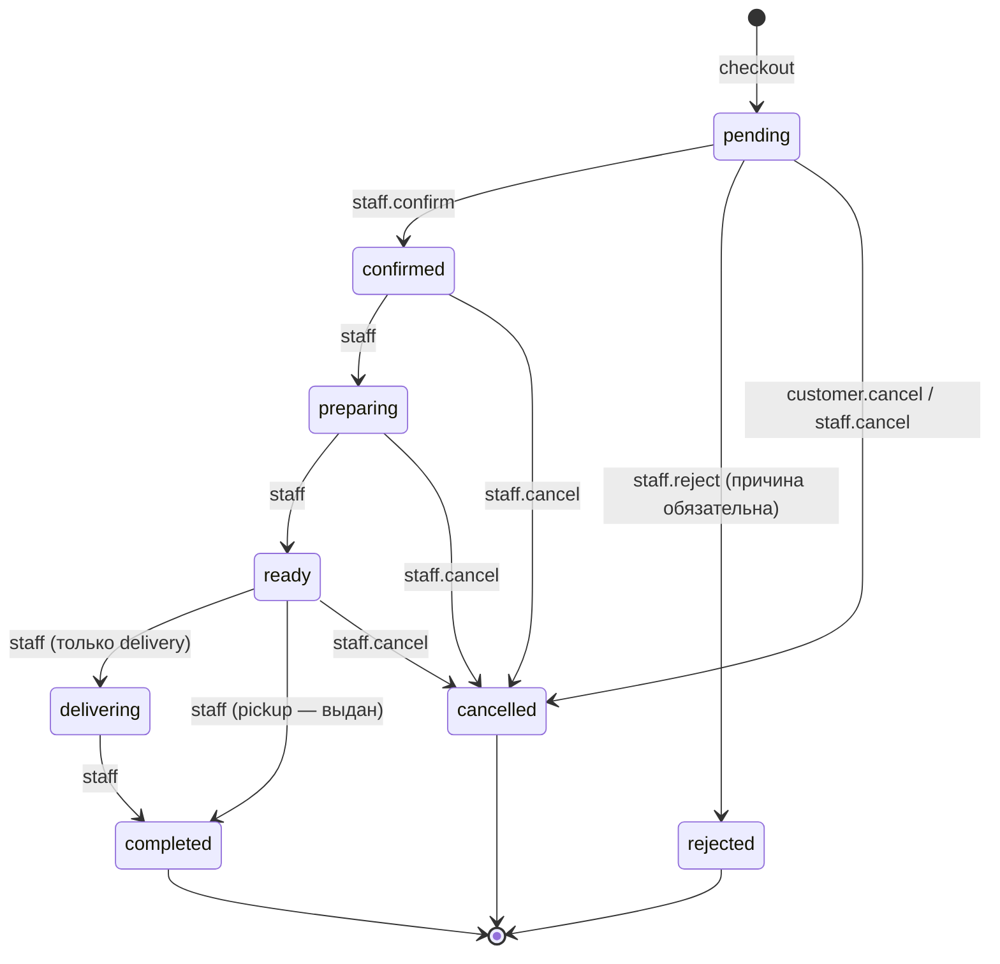

# Доменная модель

## 1. Модули backend

Модули — пакеты внутри `backend/src/app/modules/`. Модуль содержит `models.py` (ORM), `service.py` (бизнес-правила; транзакцию фиксирует сервис), при необходимости `schemas.py` (Pydantic DTO) и `router*.py` (HTTP). Роутеры тонкие: валидация входа → вызов сервиса → маппинг в DTO; роутеры не управляют сессией БД.

| Модуль | Ответственность | Зависит от |
|---|---|---|
| `tenancy` | Тенанты, домены, филиалы (`branches`), расписание, разрешение тенанта по Host/slug | — |
| `identity` | Сотрудники, роли, членства в тенантах, сессии админки | tenancy |
| `customers` | Покупатели тенанта (по телефону / Telegram id) | tenancy |
| `catalog` | Категории, товары, варианты, группы модификаторов, модификаторы, стоп-лист | tenancy |
| `pricing` | Чистая функция расчёта стоимости позиции и корзины (без I/O) | — |
| `cart` | Серверная корзина гостя, валидация позиций против каталога | catalog, pricing |
| `ordering` | Оформление (checkout), снимки, машина состояний, идемпотентность, история статусов | cart, delivery, payments, tenancy |
| `delivery` | Зоны доставки (полигон), стоимость, мин. сумма, `DeliveryProvider` | tenancy |
| `payments` | `PaymentProvider`, платежи, webhook-и, возвраты | ordering (через события) |
| `notifications` | Outbox-события → каналы (`Telegram`), шаблоны сообщений | tenancy |
| `telegram` | Боты тенантов, проверка initData, webhook бота | tenancy, identity |
| `audit` | Журнал значимых действий | — |

Модули общаются вызовами сервисов (синхронно, в одной транзакции) и событиями outbox (асинхронно, после коммита). Импорт ORM-моделей чужого модуля допускается только для чтения в запросах-проекциях; изменения — только через сервис-владелец.

## 2. Основные сущности

- **Tenant** — заведение (бренд). Валюта, часовой пояс по умолчанию, локаль, брендинг, статус (`active`/`suspended`).
- **TenantDomain** — `host` → tenant (поддомен платформы или собственный домен).
- **Branch** — филиал: адрес, координаты, часовой пояс, расписание, время приготовления, доступные способы получения и оплаты.
- **Category / Product / ProductVariant** — меню тенанта. Цена — у варианта (`price_minor`). Доступность: `is_active` и стоп-лист на уровне филиала (`stoplist_entries`).
- **ModifierGroup / Modifier** — добавки и опции: `min_selected`, `max_selected`; у модификатора `price_minor`, `max_quantity`. Группы привязываются к товару (`product_modifier_groups`).
- **DeliveryZone** — полигон (GeoJSON, point-in-polygon в приложении), стоимость доставки, мин. сумма заказа, бесплатно от суммы.
- **Cart / CartItem** — серверная корзина с секретным токеном. Позиция = вариант + модификаторы + количество. Цены не хранятся — считаются при каждом чтении.
- **Order / OrderItem / OrderItemModifier** — оформленный заказ: **снимок** названий и цен на момент оформления, контакты, адрес, способ получения, итог.
- **OrderStatusChange** — история переходов (кто, когда, из/в, причина).
- **Payment** — попытка оплаты через провайдера, внешний id, статус, суммы.
- **OutboxEvent** — событие для асинхронной доставки.
- **AuditLog** — действия сотрудников и системные события.
- **Customer** — покупатель тенанта (по телефону и/или Telegram user id). В MVP создаётся при оформлении гостевого заказа.

## 3. Машина состояний заказа

Правила:
- Переходы — явная таблица `ALLOWED_TRANSITIONS` в `ordering/state_machine.py`; любой другой переход → `409 invalid_status_transition`. Отклонение и отмена сотрудником требуют причины (`409 reason_required`).
- `delivering` допустим только для `fulfillment = delivery`; `ready → completed` — только для `pickup`.
- Покупатель может отменить только из `pending`.
- Переход выполняется под `SELECT ... FOR UPDATE` строки заказа: одновременные «подтвердить» и «отменить» не могут пройти оба.
- Каждый переход пишет `order_status_changes`, `audit_log` и outbox `order.status_changed` в той же транзакции.
- Онлайн-оплата (после MVP): статус оплаты — отдельное поле `payment_status`, не смешивается со статусом выполнения; на кухню заказ уходит после `payment.succeeded`.

## 4. Оформление заказа — инварианты

1. Тенант определён сервером; корзина принадлежит этому тенанту.
2. Филиал активен и принимает заказы выбранным способом сейчас — по его часовому поясу.
3. Каждый вариант активен и не в стоп-листе филиала; модификаторы принадлежат группам этого товара; соблюдены `min/max` групп.
4. Для доставки: координаты адреса попадают в зону доставки филиала; сумма товаров ≥ мин. сумме зоны.
5. Цены берутся **только** из БД; итог = товары + доставка. Клиент может передать `expected_total_minor` — при расхождении `409 price_changed` с актуальным расчётом.
6. Повтор с тем же `Idempotency-Key` возвращает тот же заказ; тот же ключ с другим телом → `422 idempotency_key_reused`.
7. Корзина после оформления получает статус `checked_out`; уникальный индекс `orders.cart_id` исключает двойное оформление.
8. В одной транзакции: заказ, снимки, история статуса, outbox `order.created`, audit.

## 5. Расчёт цены

`pricing.price_line(variant_price, modifiers[(price, qty)], quantity) -> int` — чистая функция на целых. Итог корзины — сумма строк + доставка. Скидки/промокоды — вне MVP; точка расширения — список корректировок в результате расчёта.
