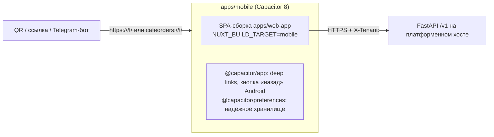

# Мобильное приложение

Решения: ADR-0005 (вариант A — Capacitor + SPA-сборка витрины), D2 (одно приложение платформы без публичного каталога заведений). Код: `apps/mobile` (нативная оболочка), `apps/web-app` (интерфейс, общий с сайтом и Telegram), `packages/core` (платформенная логика).

## Как устроено

- Интерфейс — та же витрина (каталог, блюдо, корзина, оформление, статус), без дублирования бизнес-логики; цены, доступность и правила — на сервере.
- **Заведение** выбирается кодом, ссылкой или QR; API получает `X-Tenant: <slug>`, который сервер учитывает только на хостах из `PLATFORM_API_HOSTS` и проверяет сам (ADR-0002). Публичного списка заведений в API и приложении нет.
- **«Мои заведения»** — только открытые пользователем кафе (до 20, последние сверху), можно убрать из списка.
- **Корзина — своя у каждого кафе** (`cart_token:<slug>`). Cookie на `capacitor://` не используются.
- **Хранение:** чтение — синхронно из `localStorage`, каждая запись дублируется в нативные Preferences; при старте значения восстанавливаются (iOS может очищать `localStorage` WebView при нехватке места).
- **Telegram и веб не затронуты:** мобильные плагины загружаются только в мобильной сборке (`runtimeConfig.public.platform = 'mobile'`).

## Сборка
```sh
# 1. Веб-слой (SPA) с адресом API платформы
NUXT_PUBLIC_API_BASE_URL=https://api.<платформа> pnpm --filter @nextorders/web-app run generate:mobile
#    → apps/web-app/.output-mobile/public (SSR-сборка .output не затрагивается)
# 2. Копирование в нативные проекты
cd apps/mobile && pnpm exec cap sync
# 3. Нативная сборка (нужны инструменты, см. ниже)
pnpm exec cap open android   # Android Studio → Run / Build Bundle
pnpm exec cap open ios       # Xcode → Run / Archive
```
Требования к машине сборки: Android — JDK 21 и Android SDK (Android Studio); iOS — macOS с Xcode 16+ и аккаунт Apple Developer. iOS-проект использует Swift Package Manager (CocoaPods не нужен).

## Backend для приложения
- `PLATFORM_API_HOSTS` — хост API, на который ходит приложение (например `["api.<платформа>"]`).
- `CORS_ORIGINS` — источники WebView: `["https://localhost", "capacitor://localhost"]` (Android и iOS).

## Ссылки и QR-коды
- Кастомная схема `cafeorders://t/<slug>` настроена (AndroidManifest, `Info.plist`) — работает после установки приложения.
- **App Links / Universal Links** (`https://<app-домен>/t/<slug>` открывает приложение, без него — сайт) требуют домена:
  - Android: в `AndroidManifest.xml` заменить `app.example.ru` на домен и опубликовать `https://<домен>/.well-known/assetlinks.json` с SHA-256 сертификата подписи:
    ```json
    [{
      "relation": ["delegate_permission/common.handle_all_urls"],
      "target": { "namespace": "android_app", "package_name": "<appId>", "sha256_cert_fingerprints": ["<SHA-256>"] }
    }]
    ```
  - iOS: в Xcode → Signing & Capabilities → Associated Domains → `applinks:<домен>`; опубликовать `https://<домен>/.well-known/apple-app-site-association`:
    ```json
    { "applinks": { "details": [{ "appIDs": ["<TEAMID>.<appId>"], "components": [{ "/": "/t/*" }] }] } }
    ```
- QR-код кафе = ссылка `https://<app-домен>/t/<slug>`: камера телефона откроет приложение или, если его нет, сайт.

## Проверено / не проверено
| Что | Статус |
|---|---|
| Логика выбора кафе, ссылок, списка «Мои заведения» | unit-тесты (`packages/core/test/unit/venues.test.ts`) |
| SPA-сборка, которую грузит оболочка, против реального API (X-Tenant, CORS) | Playwright-проект `mobile-app`: первый запуск без каталога, ввод кода, ошибки, заказ, сохранение после перезапуска, ссылка `/t/<slug>`, раздельные корзины кафе, 360 px |
| `cap add android/ios`, `cap sync`, deep-link конфигурация | выполнено, файлы валидны (`plutil`, XML) |
| **Нативная сборка Android/iOS** | ❌ не выполнялась: на машине разработки нет JDK, Android SDK и Xcode |
| **Проверка на реальных устройствах Android и iOS** | ❌ не выполнялась — приложение **не считается готовым** до неё |
| Push-уведомления | не реализованы: нужны проект Firebase (FCM) и ключ APNs (решение D5) |

## Публикация (после проверки на устройствах)
1. Владелец: идентификатор приложения (`appId`, неизменяем после публикации) и название — сейчас заглушки `ru.example.cafeorders` / «Заказ в кафе» (D4).
2. Иконки и экраны запуска (`@capacitor/assets` из исходников 1024×1024).
3. Аккаунты Google Play и Apple Developer, подпись релизов, политика конфиденциальности (152-ФЗ).
4. RuStore — дополнительный канал для Android в РФ (тот же AAB/APK).
