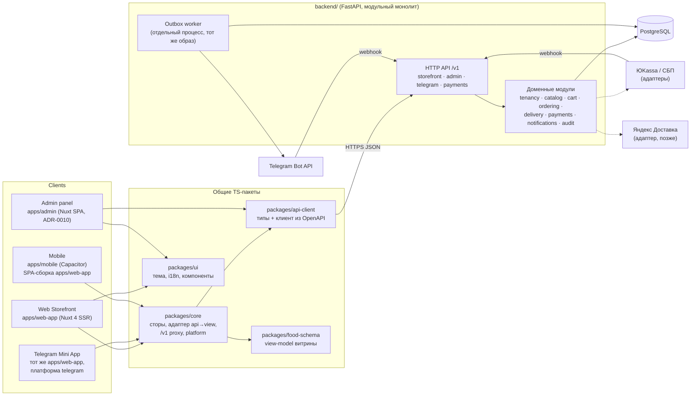
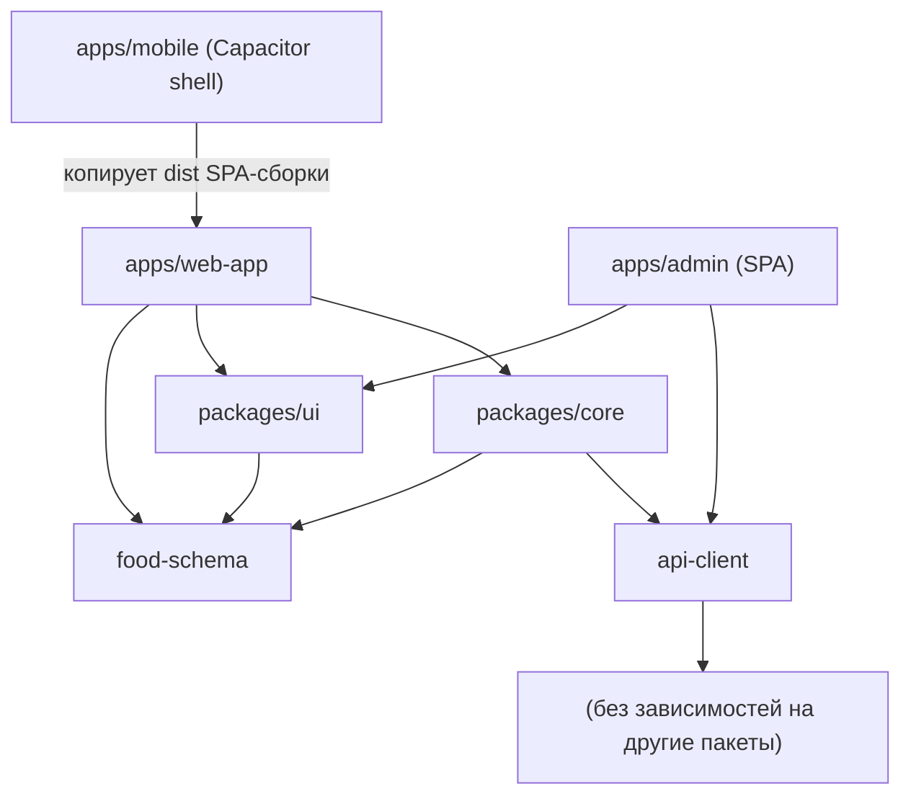

# Обзор архитектуры

Платформа прямых заказов для небольших заведений: один экземпляр backend обслуживает множество независимых тенантов (заведений), у каждого — своя витрина, Telegram-бот, брендинг, меню и заказы. Это **не маркетплейс**: нет общей корзины и общего каталога заведений.

## 1. Компоненты

## 2. Ключевые решения (кратко; детали в ADR)

| Тема | Решение | ADR |
|---|---|---|
| Стиль backend | Модульный монолит на FastAPI, один образ, два процесса (`api`, `worker`) | [0001](decisions/0001-modular-monolith.md) |
| Мультитенантность | Общая БД, `tenant_id` в каждой тенантной таблице, обязательный tenant-scope в репозиториях + PostgreSQL RLS как второй рубеж | [0002](decisions/0002-multitenancy.md) |
| Контракт | OpenAPI из FastAPI — единственный источник истины; TS-типы генерируются; `food-schema` — view-model витрины | [0003](decisions/0003-api-contract.md) |
| Корзина | Серверная корзина с секретным токеном; цены считает только сервер; заказ из корзины с `Idempotency-Key` | [0004](decisions/0004-cart-and-checkout.md) |
| Mobile | Capacitor + SPA-сборка `web-app`; одно приложение с привязкой к заведению (picker/deep link), white-label — опция | [0005](decisions/0005-mobile.md) |
| Фоновые задачи | Transactional outbox в PostgreSQL + воркер на `SKIP LOCKED`. Без Redis/Celery | [0006](decisions/0006-outbox-no-broker.md) |
| Telegram | Mini App = `web-app` с платформенным адаптером; бот на тенанта; initData проверяется на сервере | [0007](decisions/0007-telegram.md) |
| Деньги | `int` в копейках, валюта RUB на уровне тенанта | [0008](decisions/0008-money.md) |
| Сессии | непрозрачные токены в БД, cookie `HttpOnly` для админки | [0009](decisions/0009-auth-sessions.md) |
| Админка | Nuxt SPA на общем API и api-client, тот же `/v1` proxy | [0010](decisions/0010-admin-panel.md) |

## 3. Как клиенты определяют тенанта

| Клиент | Чем определяется тенант | Где проверяется |
|---|---|---|
| Web (SSR и браузер) | `Host` запроса → таблица `tenant_domains` | Backend, `TenantResolver` |
| Telegram Mini App | `Host` (Mini App URL бота = домен тенанта) **и** подпись `initData` токеном бота этого тенанта | Backend: несовпадение бота и тенанта → 403 |
| Mobile | `X-Tenant: <slug>` (выбран пользователем/deep link) → `tenants.slug` | Backend; slug — публичный идентификатор витрины, прав не даёт |
| Admin | Членство сотрудника в тенанте (`memberships`), тенант из сессии сотрудника | Backend, на каждом запросе |

Клиентский `tenant_id` никогда не используется для авторизации. Токены корзины, заказа и сессии клиента привязаны к тенанту — использование чужого токена даёт 404.

## 4. Границы frontend-пакетов

Правило: зависимости направлены только вниз; `api-client` и `food-schema` — листья. Циклов нет.

`api-client` — workspace-пакет (`workspace:*` в `core` и `web-app`) без runtime-зависимостей: типизированный `fetch` поверх сгенерированных `paths`.

### Транспорт web/Telegram → API
- Браузер ходит на тот же origin: `/v1/*`. В production это маршрутизирует reverse proxy; без него — сквозной прокси `packages/core/server/middleware/api-proxy.ts` (без логики, только пересылка с `X-Forwarded-Host`).
- SSR ходит в `NUXT_API_INTERNAL_URL` напрямую и передаёт `X-Forwarded-Host` посетителя. Поэтому backend за прокси работает с `TRUST_FORWARDED_HOST=true` и не должен быть доступен снаружи мимо прокси.
- BFF NextOrders (`packages/core/server/api/*`, Gateway) удалён: все клиенты используют один и тот же API.

| Что | Общее | Только Web | Только Telegram | Только Mobile |
|---|---|---|---|---|
| API-типы и клиент | `api-client` | | | |
| Сторы (меню, корзина, заказ), адаптер api→view | `core` | | | |
| Форматирование денег (`formatMoney`) | `api-client` | | | |
| Адаптер API → view-model food-schema, даты в часовом поясе филиала | `core/app/utils/storefront-adapter.ts` | | | |
| Токен корзины | `core` `useCartToken` (cookie) | | | заменить хранилище (Preferences) |
| Каталог, карточка, корзина, checkout | `web-app` компоненты | | | |
| SSR, SEO, sitemap, custom domain | | ✔ | | |
| initData-логин, BackButton/MainButton, тема TG, haptics | | | `core/app/platform/telegram` | |
| Push, deep links, status bar, сохранённый выбор заведения | | | | `apps/mobile` + `core/app/platform/capacitor` |

Совместимость версий API: префикс `/v1`, только аддитивные изменения внутри версии; мобильные сборки живут долго — breaking-изменения только через `/v2` с периодом поддержки обеих (см. api-contract.md).

## 5. Документы

- [domain-model.md](domain-model.md) — модули, сущности, машина состояний заказа
- [data-model.md](data-model.md) — ER-диаграмма
- [api-contract.md](api-contract.md) — API, ошибки, версионирование
- [security.md](security.md) — изоляция, аутентификация, 152-ФЗ/54-ФЗ
- [integrations.md](integrations.md) — платежи, доставка, уведомления, outbox
- [deployment.md](deployment.md) — окружения, Docker, бэкапы
